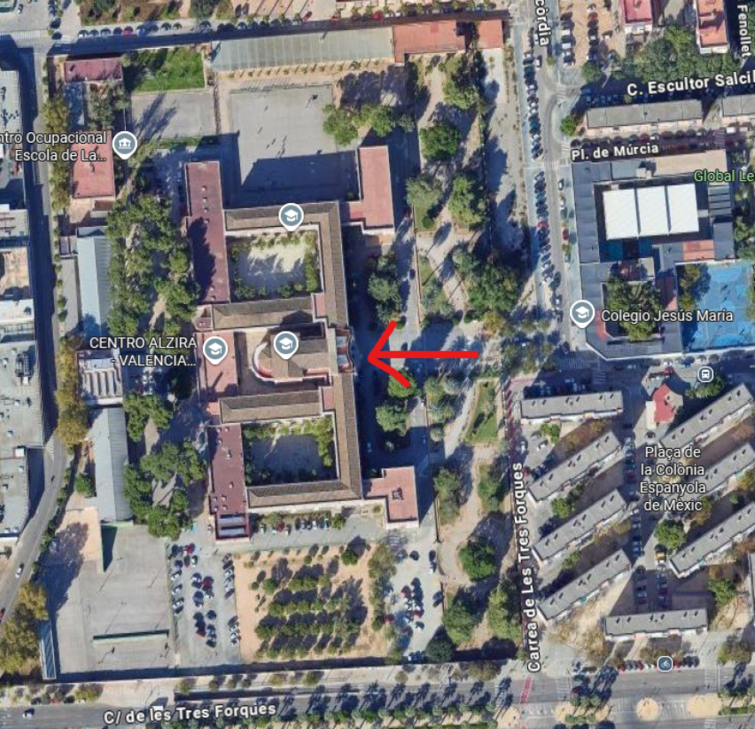

# PROTOCOLO DE EXAMEN PRESENCIAL DE LA PRIMERA EVALUACIÓN

**Fecha:** 3 de noviembre de 2026  
**Profesor:** Paco Aldarias  
**Examen:** Primera evaluación  
**Curso:** 2do de ASIR  
**Módulos:** IAW/SRI  
---

## INSCRIPCIÓN A LA PRUEBA

La inscripción a la prueba se realizará mediante un cuestionario en la página principal del aula virtual del módulo. Es importante elegir la fecha del examen a la que se acudirá. Si existe algún cambio, se debe comunicar al correo electrónico del profesor/a con antelación. Una vez lleno un turno, se tendrá que asistir al que quede libre. Los turnos se asignarán por orden de inscripción. 

Los turnos del examen se encuentran en la página principal del aula virtual del módulo y en el cuestionario correspondiente.

En caso de no saber que turno se te ha asignado, envía un correo a los profesores/as, puesto que no se aceptarán alumnos/as en un turno que no corresponda.

Unos días antes del examen se publicarán las listas de alumnos/as admitidos en cada grupo.

## INFORMACIÓN GENERAL
Todos los exámenes son presenciales. Por lo tanto, el alumnado deberá disponer de un documento identificativo (DNI, pasaporte, carnet de conducir, etc.) que se le solicitará durante la realización de la prueba.

El examen será una prueba con una parte de test y una parte práctica de 1 hora y media de duración.

## PROCEDIMIENTO

1. El alumno deberá esperar fuera del CEED y se les llamará para que entren 15 minutos antes de la hora de examen, para llevarles al lugar del examen.
2. No se podrá salir del examen hasta pasados 15 minutos una vez haya empezado el examen, y no se permitirá entrar a nadie a partir de ese momento del exterior.
3. A la prueba acudirán diferentes profesores para monitorizarlo. Si existiera cualquier sospecha de copia, el alumno en cuestión será citado para realizar la defensa de su prueba, donde se le harán las preguntas oportunas y cambios en el código, con tal de verificar que no ha habido copia.

## LUGAR DEL EXAMEN ##

Los exámenes se realizarán en el CEED  Ubicado dentro del complejo educativo Misericordia, C/ Casa de la Misericordia, 34. 46014. Valencia. 
Se deberá acceder a la capilla del complejo por la puerta principal de la misma, tal y como muestra la imagen. 

El acceso a la capilla desde la puerta principal del complejo es en linea recta.

## ¿CÓMO SE EVALUARÁ?

Como indicamos a principio de curso, el examen cuenta un 40% de la nota de la evaluación y será necesario obtener un 4 sobre 10 antes del redondeo para poder realizar la media con la práctica evaluable. De no llegar a esta nota, la nota de la prueba será la nota del examen y no se hará media.

El examen será sobre 10 puntos. 
La parte del examen de tipo test será de opción múltiple con 4 respuestas posibles, y cada 4 fallos descontará una pregunta bien.

## MATERIALES UTILIZABLES DURANTE EL EXAMEN.
No se permite ningún tipo de material.

## ¿QUÉ NECESITO EL DÍA DEL EXAMEN?
* Se necesita un bolígrafo azul o negro.
* No se dejará nada encima de la mesa.
* Todas las bolsas o mochilas se dejarán en el suelo.

## RECOMENDACIONES GENERALES
* No olvides rellenar la encuesta en plazo para conocer tanto tu disponibilidad horaria. Sin esa encuesta, ¡no puedes presentarte!
* Sé puntual.
* Pon el móvil en silencio.

## DESPUES DEL EXAMEN
• El alumnado se compromete a no reproducir ni distribuir, total o parcialmente, el examen realizado.
• Es importante permanecer atento al foro del aula virtual, al correo electrónico y/o al teléfono para recibir la retroalimentación sobre la corrección del examen u otras indicaciones que se consideren oportunas.
• El alumnado que necesite un justificante de asistencia al examen deberá solicitarlo al profesorado de la materia correspondiente.
• Las calificaciones oficiales se publicarán en ITACA Web Familia.
 Hay 3 días hábiles para reclamaciones de notas desde que estas se publican en ITACA. A partir de esa fecha no se admitirán reclamaciones.